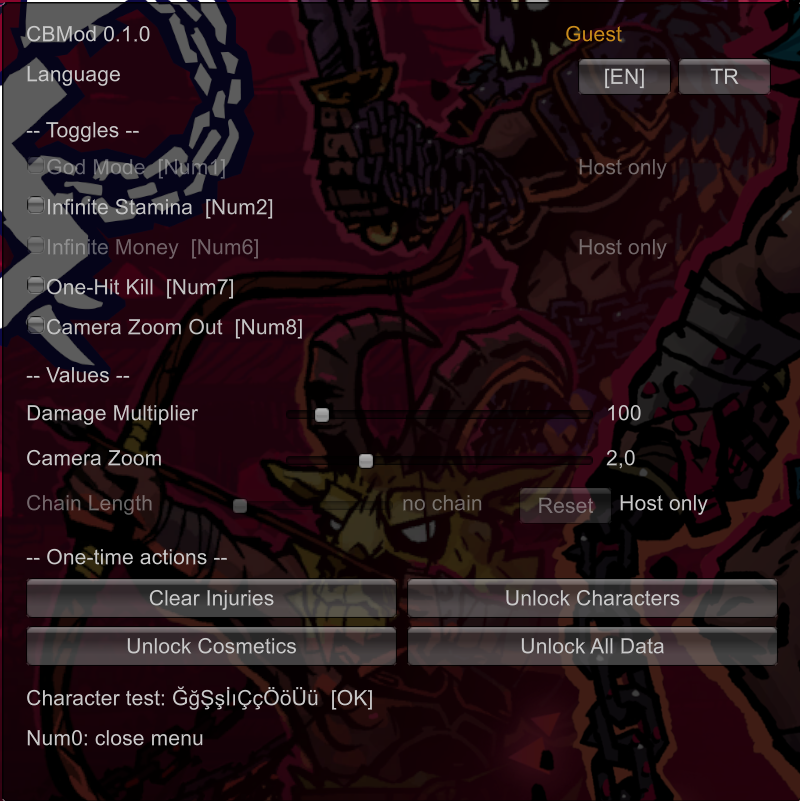
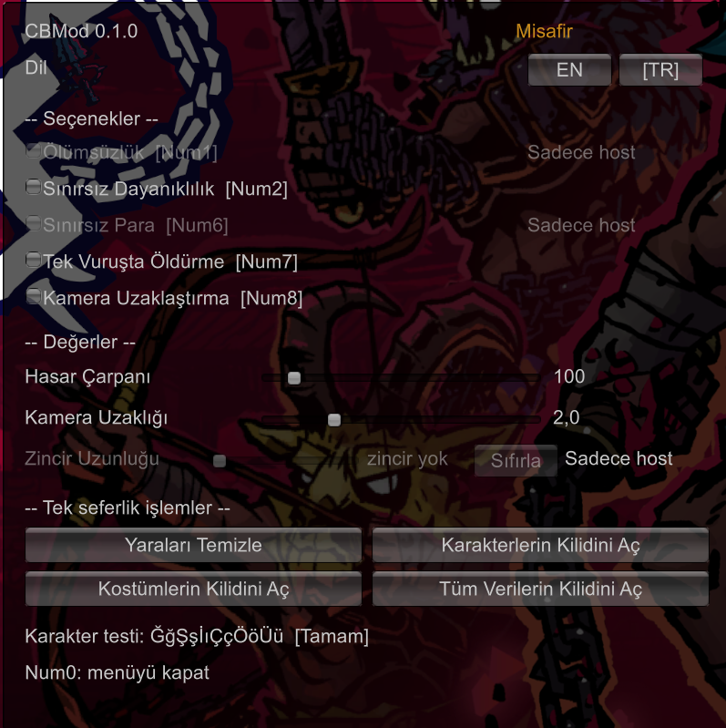

# CBMod - an unofficial mod menu for Chained Beasts

CBMod is a small [BepInEx](https://github.com/BepInEx/BepInEx) plugin for **Chained Beasts** (Steam). It adds hotkeys and
an in-game menu for things like god mode, infinite stamina, unlocks and chain length. It is meant for **single-player and
co-op PvE** play, for people who want to experiment, practice, or play with accessibility tweaks.

> **Unofficial fan tool.** This repository contains no game files, assets, or game code. You need your own copy of the game
> to use or build it. Please read the [Disclaimer](#disclaimer) below.

- Tested with: **Chained Beasts 1.0.1**, Unity **6000.3.21f1** (IL2CPP), BepInEx 6 **be.789**, Windows 10/11.
- Menu languages: **English** and **Turkish** (switchable in the menu).
- License: MIT (see [LICENSE](LICENSE)).

## Disclaimer

- **Unofficial fan project.** Not affiliated with, endorsed by, or connected to Featherweight Games. Use at your own risk.
- **Play fair.** Do not use it to gain an unfair advantage over other players. It is not intended for leaderboards or
  competitive play.
- **Shared options need consent.** Options that affect other players (god mode, money, chain length) only work for the host.
  Use them only in lobbies where everyone agrees.
- **Updates can break it.** Game updates may break the mod. If you see problems, remove it (delete the BepInEx files or
  `CBMod.dll`) before reporting bugs to the developers.

## Features

| Feature | Notes |
| --- | --- |
| God Mode | Your own character takes no damage. **Host only.** |
| Infinite Stamina | Local player. |
| Infinite Money | Keeps the run's money topped up. **Host only** (run money is shared by the group). |
| One-Hit Kill | Multiplies the damage of your attacks against enemies. The multiplier is configurable (default 100). Never affects damage to players. |
| Clear Injuries | One-shot: removes all injuries from your local character. |
| Unlock Characters | One-shot: uses the game's own unlock function for all beasts. Backs up your save first. |
| Unlock Cosmetics | One-shot: completes the achievement progress stored in the save that gates each cosmetic. Backs up your save first. Real Steam achievements are **not** touched. |
| Unlock All Data | One-shot: calls the game's own "unlock all data" function. Tells you if there was nothing left to unlock. Backs up your save first. |
| Camera Zoom Out | Local only. Scales the arena camera's framing range. The factor is configurable. |
| Chain Length | Longer / shorter / reset. **Host only.** Also available as a slider in the menu. |
| In-game menu | Everything above in one window, with a Host / Guest indicator. |
| Sound feedback | A high beep when something is switched on, a low beep when it is switched off, a confirmation sound for one-shot actions and a warning sound when an action is refused. The sounds are generated in code, no audio files are used. |

## Screenshots

The in-game menu in English and in Turkish. Both were taken as a guest, so the host-only items (God Mode, Infinite Money,
Chain Length) are greyed out and marked "Host only".




## Security

- Only download releases from [this repository](https://github.com/methsploit-sh/ChainedBeastsMod/releases), verify the
  SHA256 checksum, and beware of fake trainers or look-alike repositories.
- This project never asks you to disable antivirus or run unknown executables. A release contains only the official
  BepInEx files and `CBMod.dll`: there is no `.exe` of ours, no installer and no "loader".
- To check a download in PowerShell: `Get-FileHash .\ChainedBeastsMod-vX.Y.Z.zip -Algorithm SHA256` and compare the result
  with the `.sha256` file published next to the zip. If they differ, delete the file.
- You can also build everything yourself from source (see [Building from source](#building-from-source)).

## Installation

### Option A: ready-made package (easiest)

1. Download `ChainedBeastsMod-vX.Y.Z.zip` from the
   [Releases](https://github.com/methsploit-sh/ChainedBeastsMod/releases) page of this repository, and nowhere else.
   Compare its SHA256 with the `.sha256` file next to it (see [Security](#security)).
2. Close the game. Open the game folder (Steam: right-click the game, *Manage*, *Browse local files*).
3. Extract the zip **into the game folder**, so that `winhttp.dll` ends up next to `ChainedBeasts.exe` and
   `CBMod.dll` ends up in `BepInEx\plugins`.
4. Start the game once. The **first start takes a while**: BepInEx generates its IL2CPP interop files and the game window
   may stay black for a minute or two. This only happens once (and again after a game update).
5. In game, press **Numpad0** to open the menu.

The package contains an unmodified copy of the official BepInEx build. See [THIRD_PARTY_NOTICES.md](THIRD_PARTY_NOTICES.md)
for its source and license (LGPL-2.1).

### Option B: install BepInEx yourself, then add CBMod.dll

1. Download **BepInEx 6 bleeding edge, build be.789 or newer, "Unity IL2CPP", Windows x64** from the official builds page:
   <https://builds.bepinex.dev/projects/bepinex_be>
   (source and license: <https://github.com/BepInEx/BepInEx>).
2. Extract it into the game folder, next to `ChainedBeasts.exe`.
3. Start the game once and quit, so `BepInEx\interop` and `BepInEx\plugins` exist.
4. Copy `CBMod.dll` (from the
   [Releases](https://github.com/methsploit-sh/ChainedBeastsMod/releases) page, or built yourself) into `BepInEx\plugins`.
5. Start the game. Check `BepInEx\LogOutput.log` for the line `CBMod ... loaded`.

### Uninstall

Delete `BepInEx\plugins\CBMod.dll`. To remove BepInEx completely, delete the `BepInEx` folder, `winhttp.dll`,
`doorstop_config.ini`, `.doorstop_version`, `changelog.txt` and the `dotnet` folder from the game folder. Verifying the game files in Steam
also works.

## Keys

All keys are Numpad keys and can be changed in the config file (see below). NumLock should be on.

| Key | Action |
| --- | --- |
| Numpad0 | Open / close the menu (Esc also closes it) |
| Numpad1 | God Mode (host only) |
| Numpad2 | Infinite Stamina |
| Numpad3 | Clear Injuries |
| Numpad4 | Unlock Characters |
| Numpad5 | Unlock All Data |
| Numpad6 | Infinite Money (host only) |
| Numpad7 | One-Hit Kill |
| Numpad8 | Camera Zoom Out |
| Numpad9 | Unlock Cosmetics |
| Numpad + | Chain longer (host only) |
| Numpad - | Chain shorter (host only) |
| Numpad * | Reset chain length (host only) |

The hotkeys and the menu share the same state: switching something on with a key shows it ticked in the menu and the
other way round.

## The in-game menu

- Opens with **Numpad0**. While it is open, the mouse cursor is released and the game's own input is switched off, so
  clicking the menu does not make your character attack. The game keeps running behind it. When the menu closes, the
  cursor and the game's input are restored.
- Items that need the host (God Mode, Infinite Money, Chain Length) are greyed out when you are not the host and are
  marked **Host only**. The top right of the menu shows whether you are currently **Host** or **Guest**.
- The sliders change the damage multiplier, the camera zoom factor and the chain length.
- The bottom of the menu has a character test line (`ĞğŞşİıÇçÖöÜü`) that shows whether the font can draw Turkish letters.
- If the menu ever fails to draw, it closes itself, gives the input back, and logs the reason once.

### Language

The default language is **English**. Switch with the **EN / TR** buttons in the menu or set `Language` in the config.
Only the menu and the on-screen messages are translated; log lines and config comments are always English.

## Configuration

The config file is created on first start: `BepInEx\config\org.methsploit.cbmod.cfg`. Edit it with the game closed; the menu sliders
and the language buttons write to it as well.

| Section | Setting | Default | Meaning |
| --- | --- | --- | --- |
| Keys | `GodMode`, `InfiniteStamina`, `ClearInjuries`, `UnlockCharacters`, `UnlockAllData`, `InfiniteMoney`, `OneHitKill`, `CameraZoomOut`, `UnlockCosmetics` | `Numpad1`..`Numpad9` | Key names from Unity's Input System `Key` enum (`Numpad0`-`Numpad9`, `NumpadPlus`, `NumpadMinus`, `NumpadMultiply`, `F1`, `Digit1`, ...). |
| Keys | `ChainLengthIncrease`, `ChainLengthDecrease`, `ChainLengthReset` | `NumpadPlus`, `NumpadMinus`, `NumpadMultiply` | Chain hotkeys. |
| Keys | `ToggleMenu` | `Numpad0` | Opens / closes the menu. |
| Values | `DamageMultiplier` | `100` | One-Hit Kill multiplier (1-1000). |
| Values | `CameraZoomFactor` | `2.0` | Camera zoom-out factor (1-5). |
| Values | `CameraZoomMethod` | `Auto` | `Auto`, `Distance`, `Fov` or `Both`. Try another value if Auto shows no change. |
| Values | `ChainLengthStep` | `0.5` | How much one key press changes the chain length. |
| Values | `InfiniteMoneyAmount` | `99999` | Money is topped up to this amount. |
| Menu | `Language` | `EN` | `EN` or `TR`. |
| Menu | `BlockGameInput` | `true` | Disable the game's input while the menu is open. Turn off if it causes problems. |
| Save | `BackupDir` | empty | Where save backups go. Empty = `Documents\CBMod-SaveBackups`. |
| Save | `SaveAfterUnlock` | `true` | Call the game's save function after an unlock. |
| Audio | `BeepVolume` | `0.5` | Volume of the beeps (0-1). |
| Audio | `PlayMode` | `Play` | `Play`, `OneShot` or `AtPoint`. Try another value if you hear nothing. |

## Warnings, please read

- **Chain, money and god mode affect the whole lobby.** The chain connects every player, and run money is shared. These
  features only work when you are the **host**; as a guest they are refused (with a warning sound and a log line).
- **Unlocking changes your save.** Before every unlock the mod copies `SaveData`, `SaveDataPrivate` and `Settings` to
  `Documents\CBMod-SaveBackups\<date-time>\`, and the path is written to the log. If the backup fails, the unlock is
  cancelled. To restore, close the game and copy those files back into
  `%USERPROFILE%\AppData\LocalLow\Featherweight Games\ChainedBeasts\`.
- **Steam Cloud.** Steam may sync your save. If a restored or changed save gets overwritten, turn Steam Cloud off for the
  game (Steam, game properties, General) while you restore, and check the result before turning it back on.
- **Steam achievements are never granted** by this mod. Unlock Cosmetics only edits the progress stored in the save file.
- **Game updates can break the mod.** The plugin patches internal game methods that can change in any update. If something
  stops working after an update, check `BepInEx\LogOutput.log`, and delete `BepInEx\interop` and `BepInEx\cache` so they
  are regenerated. Wait for a CBMod update if it still fails.
- **No warranty.** Modding may go against the game's or platform's terms, and the mod is provided as is (see the license).
  Back up your saves yourself too if they matter to you.

## Troubleshooting

| Problem | What to try |
| --- | --- |
| Nothing happens, no menu | Make sure `BepInEx\plugins\CBMod.dll` exists and `BepInEx\LogOutput.log` contains `CBMod ... loaded`. If the log has no BepInEx lines at all, the BepInEx files are not next to `ChainedBeasts.exe`. |
| Black screen / long start after install | Normal on the first start: interop files are being generated. Wait a few minutes. |
| Keys do nothing | NumLock must be on. Check the key names in the config. |
| No sound | Change `Audio / PlayMode` (`Play`, `OneShot`, `AtPoint`) and check `BeepVolume`. Look for `Beeper` lines in the log. |
| Menu does not appear | Look for `IMGUI probe` and `Menu draw error` lines in the log and include them in a bug report. |
| Game input stays blocked after the menu | Set `Menu / BlockGameInput` to `false`. |
| A feature says "host only" | You are not the host of the current session. Host the game (solo play counts as host). |
| Zoom shows no change | Try `CameraZoomMethod = Fov` or `Distance`; include the `Camera dump` lines of the log in a bug report. |
| Wrong letters in the menu | Look at the `Font check` line in the log. |
| Error about a method that "unstripping failed" | That game method was removed from the build by the compiler. Report it with the log. |

When reporting a bug, please attach `BepInEx\LogOutput.log` (and mention your game version).

## Building from source

You need your own installed copy of the game, because the plugin compiles against the game's generated interop assemblies,
which cannot be redistributed. That is also why there is no automated build in this repository.

1. Clone the repository:

   ```powershell
   git clone https://github.com/methsploit-sh/ChainedBeastsMod.git
   cd ChainedBeastsMod
   ```
2. Install the game, install BepInEx 6 IL2CPP (Option B above), and start the game once so `BepInEx\interop` exists.
3. Install the [.NET SDK](https://dotnet.microsoft.com/download) (the project targets `net6.0`; the SDK downloads the
   reference pack from NuGet, so you need internet on the first build).
4. Build:

   ```powershell
   dotnet build CBMod\CBMod.csproj -c Release
   # game not in the default Steam folder?
   dotnet build CBMod\CBMod.csproj -c Release -p:GameDir="D:\Games\Chained Beasts"
   ```

   The result is `CBMod\bin\Release\net6.0\CBMod.dll`. Copy it to `BepInEx\plugins`.
5. To build a release package, download the official BepInEx 6 IL2CPP win-x64 zip and run:

   ```powershell
   .\scripts\package.ps1 -BepInExZip "C:\path\to\BepInEx-Unity.IL2CPP-win-x64-6.0.0-be.789+<commit>.zip"
   ```

   This builds the plugin, adds `CBMod.dll` to the BepInEx files, refuses to continue if any game or interop file ends up
   in the package, and writes `dist\ChainedBeastsMod-v<version>.zip` plus a `.sha256` file.

The version number lives in one place: `<Version>` in `CBMod\CBMod.csproj`.

### Code layout

| File | What it does |
| --- | --- |
| `Plugin.cs` | Entry point: registers the component, binds the config, applies the Harmony patches. |
| `Controller.cs` | All feature actions. Hotkeys and the menu both call these. |
| `Hud.cs` | The IMGUI menu. Uses manual `Rect` layout because `GUILayout` is partly stripped in IL2CPP builds. |
| `Localization.cs` | The translation table. |
| `Features.cs`, `Actions.cs` | Shared state, host check, one-shot actions (unlocks, chain, injuries). |
| `GodModePatch.cs`, `StaminaPatch.cs`, `DamagePatch.cs` | Harmony patches. |
| `CameraZoom.cs` | Camera zoom. |
| `Beeper.cs`, `Fonts.cs`, `SaveBackup.cs`, `Config.cs` | Generated sounds, font check, save backups, config. |

## Contributing

Bug reports and pull requests are welcome. Please keep the safety rules: anything that affects the chain or the lobby must
be host-only, anything that writes the save must take a backup first, and user-visible text goes through `Localization.cs`.
Log messages and config descriptions stay in English.

### Adding or fixing a translation

All text the player sees is in `CBMod\Localization.cs`, as `key -> { English, Turkish }`.

1. To fix a string, edit it in the table.
2. To add a language, add a third entry to every row, add the language code to `Loc.Index` and to the allowed values of
   `Language` in `Config.cs`, and add a button next to EN / TR in `Hud.cs`.
3. If your language needs letters the default font lacks, extend the check in `Fonts.cs`.
4. Save the file as UTF-8.

## Credits

- [BepInEx](https://github.com/BepInEx/BepInEx) and its components (HarmonyX, Il2CppInterop, ...), by the BepInEx team.
- *Chained Beasts* is made by Featherweight Games. All rights to the game belong to them.
